# Ferie & Disponibilità · Synlab Manifattura Firenze

App web per gestire ferie e disponibilità della **Radiologia di Synlab Manifattura Firenze**. Funziona da browser su **PC, iPhone/iPad, Android e macOS** (stessa interfaccia responsive, installabile sulla schermata Home).

Il coordinatore può creare gli accessi del team direttamente dall'app, senza usare il terminale.

Flusso completo:

1. Il dipendente o il libero professionista accede e seleziona i giorni sul calendario.
2. Sceglie **Ferie**, **Permesso** (giornata intera, mattina, pomeriggio o un orario personalizzato) oppure **Disponibilità** (non disponibile / disponibile) e aggiunge una nota.
3. Il coordinatore riceve un'**email** con il riepilogo e un link per **approvare o rifiutare**.
4. Alla decisione parte un'**email di esito** al richiedente (con file `.ics` se approvata).
5. I giorni approvati compaiono nel **calendario condiviso** visibile a tutti, e restano disponibili come calendario `.ics` iscrivibile su iPhone/Android/Google Calendar.
6. Il coordinatore ha una coda con contatori, statistiche del mese e il registro di tutte le email inviate.

Nessuna dipendenza esterna: solo Python 3.8+ e il browser. I dati restano in `data/db.json`.

---

## Avvio rapido

```bash
python3 server.py
```

Apri <http://localhost:8080>. Al primo avvio vengono creati quattro account dimostrativi:

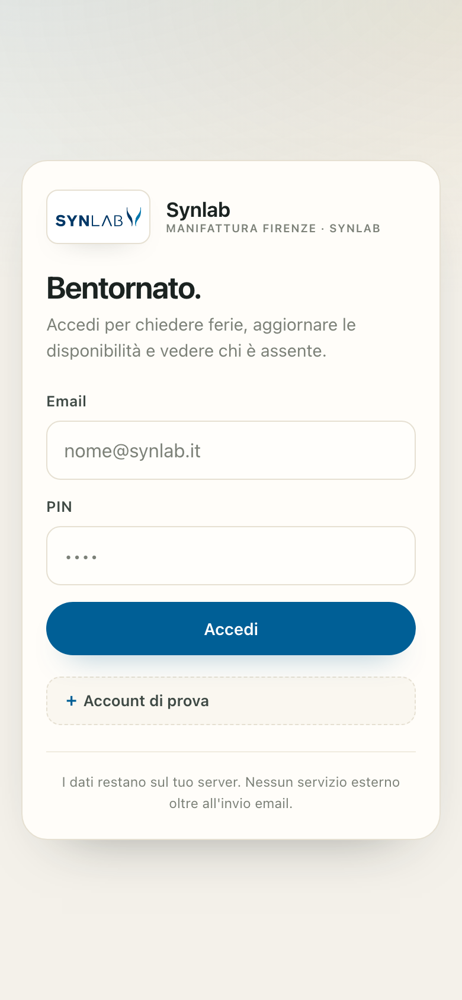

| Ruolo | Email | PIN |
|---|---|---|
| Dipendente | giulia@studio.it | 1111 |
| Dipendente | luca@studio.it | 2222 |
| Libero professionista | sara@studio.it | 3333 |
| Coordinatore | coordinatore@studio.it | 1234 |

Senza credenziali email l'app funziona in **modalità simulata**: le email vengono salvate in `data/outbox/` e sono consultabili dal coordinatore nella sezione *Coordinamento → Registro email*. Questo permette di provare l'intero flusso (decisione inclusa) senza configurare nulla.

> Cambia i PIN dimostrativi prima dell'uso reale: menu utente → **Cambia PIN**, oppure `python3 server.py setpin --email ... --pin ...`.

Nel database locale sono presenti alcune richieste di esempio (ferie, permesso e disponibilità) per esplorare subito calendario, coda del coordinatore e registro email. Per ripartire da zero cancella la cartella `data/`: al riavvio vengono ricreati solo i quattro account dimostrativi.

---

## Primo utilizzo: il tutorial guidato

Al primo accesso, dopo il login, parte automaticamente una guida di pochi passi che evidenzia le parti importanti dello schermo: calendario, selezione dei giorni, modulo della richiesta, stato delle richieste e, per il coordinatore, coda di approvazione, persone del team e registro email.

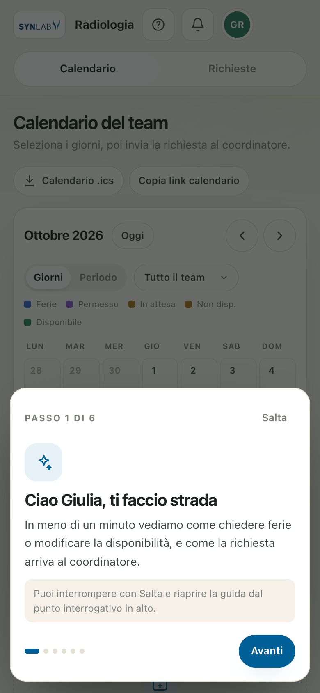

- Si può interrompere con **Salta**, proseguire con **Avanti** o tornare con **Indietro**; funzionano anche le frecce della tastiera e `Esc` per chiudere. Durante la guida il resto dell'app non è raggiungibile per sbaglio con Tab o con un tocco.
- Il tutorial si mostra una sola volta per utente. Per rivederlo: pulsante **?** nella barra in alto oppure menu utente → **Rivedi il tutorial**.
- Su telefono la scheda si posiziona in alto o in basso a seconda dello spazio disponibile, così i pulsanti restano vicini al pollice. Gli elementi molto alti (per esempio il calendario) possono scorrere sotto la scheda, che resta sempre sopra il contenuto.
- Il tutorial è memorizzato nel browser (`localStorage`); svuotando i dati del sito verrà riproposto.

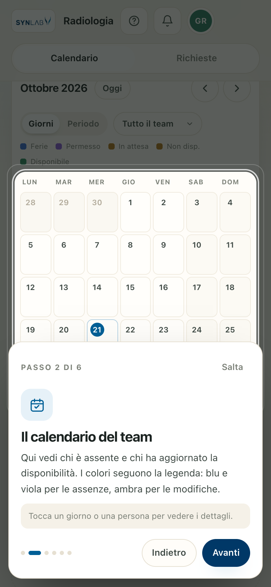

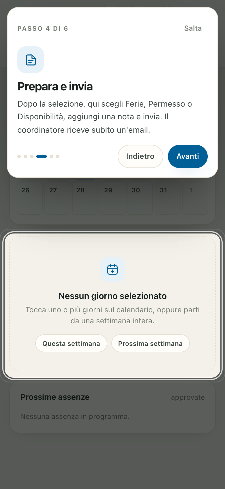

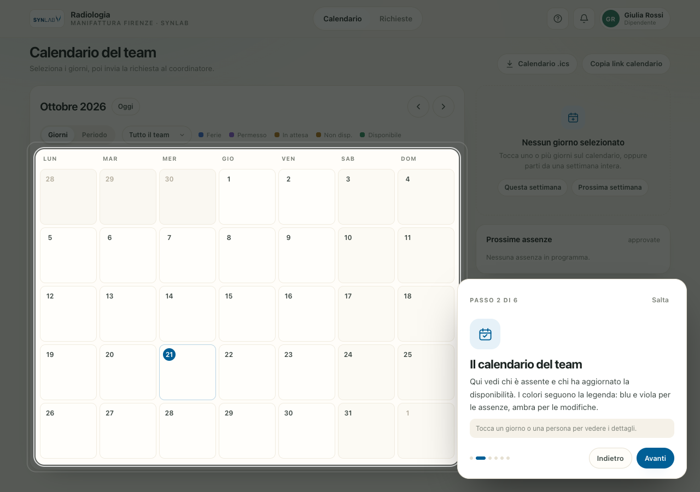

Le animazioni sono volutamente brevi (200–300 ms), non bloccano l'interfaccia e rispettano `prefers-reduced-motion`: chi ha attivato “Riduci movimento” sul dispositivo vede transizioni immediate.

---

## Aprire l'app dal telefono

L'interfaccia è già responsive e installabile come PWA. Per raggiungerla da iPhone, iPad o Android:

```bash
python3 server.py --lan
```

Il comando mostra un indirizzo del tipo `http://192.168.1.42:8080`: aprilo nel browser del telefono, **sulla stessa rete Wi-Fi del computer**. In alternativa:

```bash
HOST=0.0.0.0 python3 server.py
```

Note utili:

- Se l'indirizzo non si apre, controlla il firewall del computer e che il telefono non sia su una rete ospiti isolata.
- Su iPhone: Safari → **Condividi → Aggiungi alla schermata Home**. Su Android: Chrome → menu → **Installa app**.
- Fuori casa serve un URL raggiungibile da Internet (dominio + reverse proxy HTTPS, oppure un tunnel come Cloudflare Tunnel/Tailscale). In quel caso imposta `APP_BASE_URL` con lo stesso indirizzo pubblico: i link nelle email devono essere apribili dal telefono.
- Con l'app aperta da un indirizzo di rete locale, i link nelle email funzionano solo finché il telefono è sulla stessa rete.

---

## Configurazione

Copia `.env.example` in `.env` e compila solo ciò che ti serve.

```bash
cp .env.example .env
```

| Variabile | Descrizione |
|---|---|
| `PORT` | Porta HTTP (default `8080`) |
| `HOST` | Interfaccia di ascolto (default `127.0.0.1`; usa `0.0.0.0` per la rete locale) |
| `DATA_DIR` | Cartella dati alternativa (default `./data`) |
| `ORG_NAME` | Nome completo usato nelle email e nel titolo (default `Synlab Manifattura Firenze`) |
| `ORG_SHORT` | Nome breve nella barra in alto (default `Synlab`) |
| `ORG_SITE` | Sede mostrata sotto il nome (default `Manifattura Firenze`) |
| `ORG_BRAND` | Marchio mostrato accanto alla sede (default `SYNLAB`) |
| `APP_BASE_URL` | URL pubblico dell'app (es. `https://ferie.iltuostudio.it`), usato nei link delle email |
| `RESEND_API_KEY` | Chiave API [Resend](https://resend.com) per l'invio email via HTTPS |
| `MAIL_FROM` | Mittente verificato, es. `ferie@iltuostudio.it` |
| `MAIL_FROM_NAME` | Nome mittente |
| `MAIL_REPLY_TO` | Reply-To facoltativo (es. email del coordinatore) |
| `SMTP_HOST`, `SMTP_PORT`, `SMTP_USER`, `SMTP_PASS` | Alternativa SMTP (Gmail, Outlook, Aruba, ecc.) |
| `SMTP_STARTTLS` | `1` (default, porta 587) oppure `0` per SSL diretto (porta 465) |
| `COORDINATOR_EMAILS` | Email aggiuntive che ricevono le richieste, separate da virgola |
| `REMINDER_HOURS` | Dopo quante ore inviare un promemoria al coordinatore per una richiesta ancora in attesa (default `24`, `0` per disattivarlo) |

Sono supportati sia **Resend** sia un normale **SMTP**. Senza nessuno dei due resta attiva la modalità simulata.

### Cosa contiene ogni email

- **Richiesta al coordinatore**: riepilogo in tabella (richiedente, ruolo, tipo, fascia, periodo, giorni, nota), pulsanti **Approva** e **Rifiuta** che aprono la pagina di conferma (nessuna decisione viene presa da un semplice clic sul link), link all'app e `Reply-To` impostato sull'email del richiedente, così il coordinatore può rispondere direttamente.
- **Esito al richiedente**: esito evidenziato, dettagli, eventuale nota del coordinatore e, se approvata, allegato `.ics` pronto per Apple/Google Calendar.
- **Promemoria**: una sola email per richiesta ancora in attesa dopo `REMINDER_HOURS` ore.
- **Email di prova**: dal registro email, per verificare subito che il provider funzioni.

Tutte le email sono responsive (Gmail, Outlook, Apple Mail), hanno una versione testuale, un preheader e un `Message-ID` coerente. Gli invii usano una chiave di idempotenza quando il provider la supporta, così un doppio clic non genera doppioni. Il registro mostra mittente, destinatario, errori e consente di **reinviare** un messaggio fallito (anche con l'allegato `.ics`).

### Mittente Resend

1. Crea un account e verifica il dominio del mittente.
2. Genera una chiave API.
3. Imposta `RESEND_API_KEY` e `MAIL_FROM` nel `.env` e riavvia il server.

### Mittente SMTP

Esempio con un provider che espone SMTP:

```env
SMTP_HOST=smtp.example.com
SMTP_PORT=587
SMTP_USER=ferie@example.com
SMTP_PASS=la-tua-password-o-app-password
MAIL_FROM=ferie@example.com
```

> Per Gmail serve una "password per le app" e l'account deve avere la verifica in due passaggi attiva.

### Deliverability

Per evitare che le email finiscano in spam, usa un dominio tuo e configura **SPF**, **DKIM** e **DMARC** presso il provider (Resend li configura guidandoti nella verifica del dominio; con SMTP usa il dominio del provider o configura i record DNS). Evita `MAIL_FROM` su domini gratuiti quando possibile.

### Link nelle email

I link di approvazione usano `APP_BASE_URL` se impostato, altrimenti l'indirizzo con cui il browser ha raggiunto il server. Per inviare email utilizzabili da telefono o da un altro computer serve un URL raggiungibile (dominio pubblico o rete locale con `HOST=0.0.0.0`).

---

## Persone e accessi

Il flusso consigliato è dall'interfaccia:

1. Accedi come **coordinatore** e apri **Coordinamento**.
2. Nella scheda **Persone del team** tocca **Aggiungi persona**.
3. Inserisci nome, email e ruolo. Scegli un **colore personale** e, se vuoi, carica una **foto**: il colore è già proposto tra quelli non usati, così ogni persona resta distinguibile.
4. Il PIN iniziale di 6 cifre viene generato automaticamente e puoi rigenerarlo.
5. Dopo la creazione, usa **Copia credenziali** e consegnale alla persona. Il PIN non viene inviato per email e non è più visibile dopo aver chiuso la finestra.
6. Al primo accesso la persona trova automaticamente il tutorial; può cambiare PIN, colore e foto dal menu in alto a destra.

Solo i coordinatori possono elencare e creare utenti. Tocca una persona nell'elenco per cambiarne colore e foto; ognuno può comunque modificare il proprio aspetto dal menu. La creazione non richiede il riavvio del server e il nuovo nome compare subito nel calendario e nei filtri del team. La creazione dall'app disattiva i collegamenti agli account dimostrativi nella schermata di login; gli utenti demo già presenti nel database restano visibili finché non vengono rimossi con il comando CLI qui sotto.

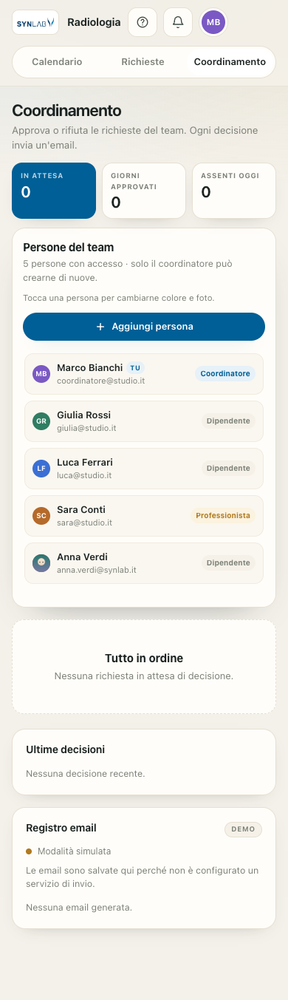

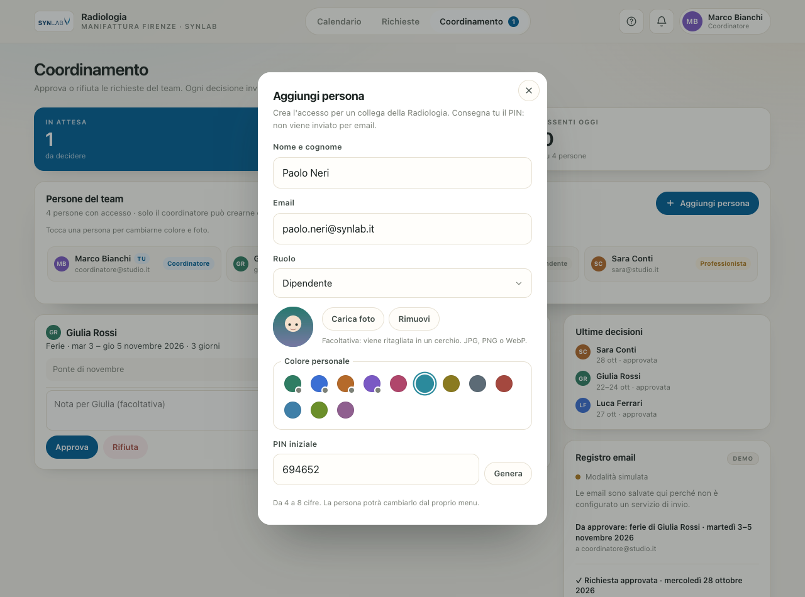

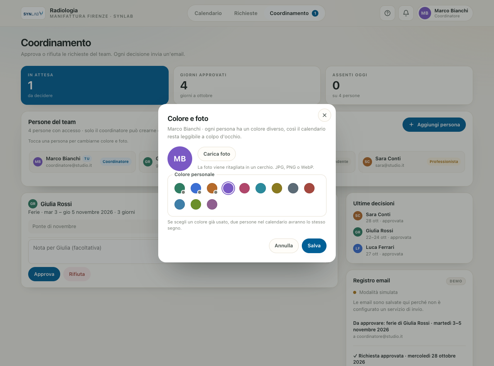

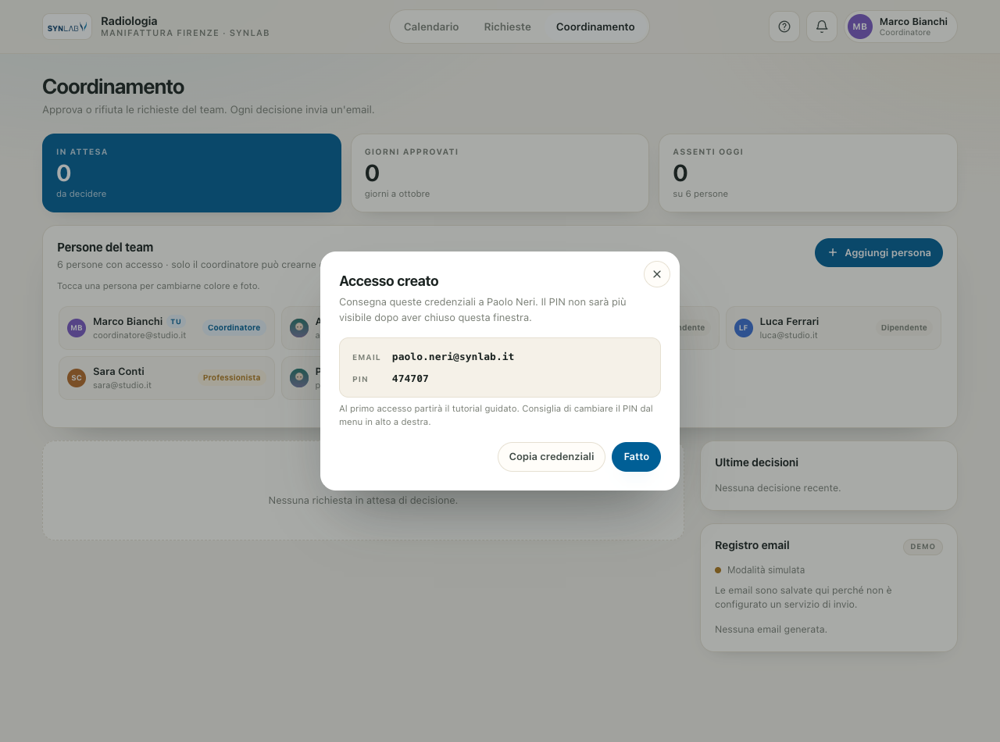

La foto viene ridimensionata nel browser (ritaglio quadrato, JPEG leggero) e salvata in `data/avatars/`; il database conserva solo il nome del file. Il servizio foto richiede una sessione attiva: senza accesso le immagini non sono scaricabili.

### Gestione da terminale

```bash
python3 server.py listusers
python3 server.py adduser --name "Anna Verdi" --email anna.verdi@synlab.it --role dipendente --pin 4821
python3 server.py adduser --name "Paolo Neri" --email paolo.neri@synlab.it --role professionista --pin 7788
python3 server.py adduser --name "Elena Blu" --email elena.blu@synlab.it --role coordinatore --pin 9931
python3 server.py setpin --email anna.verdi@synlab.it --pin 1234
python3 server.py removeuser --email anna.verdi@synlab.it
```

Ruoli: `dipendente`, `professionista`, `coordinatore`. Solo i coordinatori vedono il tab **Coordinamento**, ricevono le email di richiesta e possono decidere. Un coordinatore può comunque inviare le proprie richieste (le decide un altro coordinatore, o lo stesso dall'app).

Il PIN è salvato come hash `scrypt` con salt; l'app non conserva mai il PIN in chiaro.

---

## Calendario condiviso e `.ics`

Nel calendario si vedono:

- **Ferie approvate** di tutto il team, con il colore della persona.
- **Permessi e disponibilità** con lo stesso colore della persona; la lettera nel segno indica il tipo: `F` ferie, `P` permesso, `N` non disponibile, `D` disponibile. Per i permessi con **orario personalizzato** il dettaglio mostra la fascia scelta, per esempio `09:00–13:00`.
- Le **proprie richieste in attesa** (tratteggio). Il coordinatore vede anche quelle degli altri.
- Un avviso quando nei giorni scelti ci sono già colleghi assenti.

Ogni persona ha un colore diverso, usato anche nell'avatar, nelle richieste e nell'elenco del team. Su telefono i giorni mostrano il segno colorato con la lettera del tipo, così il calendario resta leggibile anche in poco spazio.

Le **domeniche** sono evidenziate in rosso perché non sono giorni lavorativi, ma restano visibili nel calendario e selezionabili come gli altri giorni.

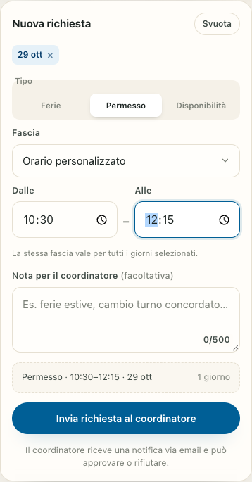

Il pulsante `.ics` scarica il calendario approvato; **Copia link calendario** produce un URL da aggiungere come calendario iscritto in Google Calendar, Apple Calendar o Outlook (su iPhone: *Impostazioni → Calendario → Account → Aggiungi account → Altro → Aggiungi calendario con abbonamento*).

---

## Tema chiaro e scuro

Dal menu in alto a destra, sezione **Tema**, si sceglie tra tre modalità:

- **Sistema** (predefinita): segue l'impostazione di iOS, Android, macOS o Windows e cambia in tempo reale quando il dispositivo passa da chiaro a scuro.
- **Chiaro** e **Scuro**: forzano il tema anche se il dispositivo usa l'altro.

La scelta resta memorizzata nel browser del dispositivo e non modifica quella dei colleghi. Cambia anche il colore della barra del browser (`theme-color`) e il calendario viene ridisegnato subito con i colori corretti per il contrasto.

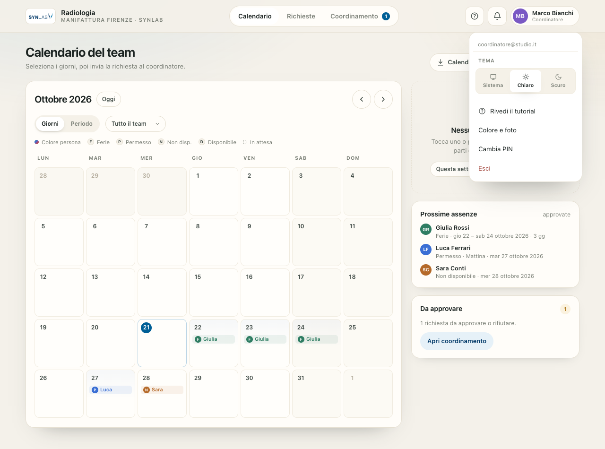

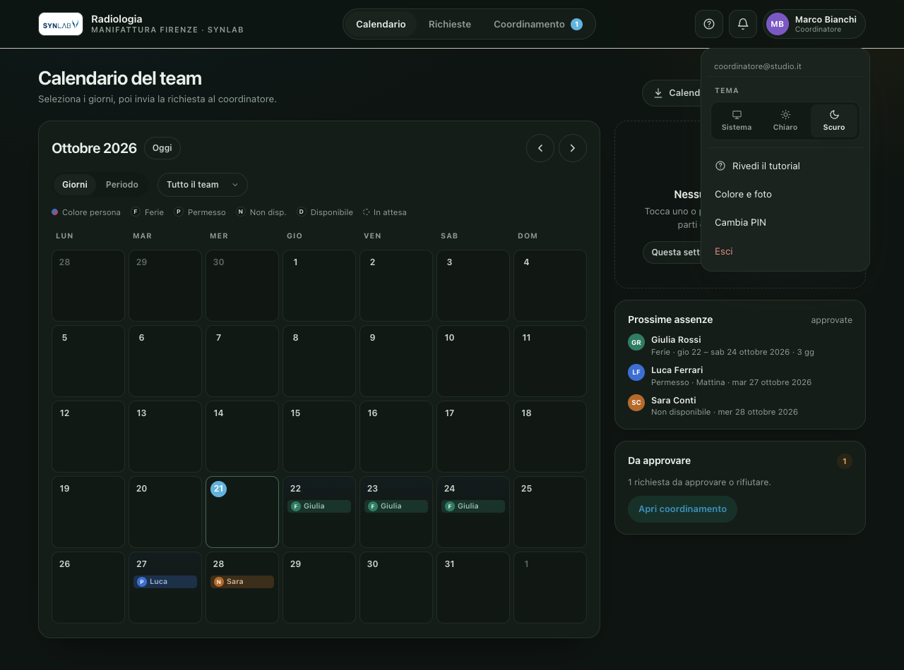

---

## Test

```bash
python3 -m unittest discover -s tests -v
```

Le **12 verifiche** avviano un server isolato con una cartella dati temporanea e coprono accesso e permessi, creazione richiesta, permessi con fascia oraria, **orario personalizzato** (normalizzazione, validazione, calendario ed email), approvazione dal link email anche senza login, rifiuto, calendario condiviso, notifiche, statistiche del coordinatore, reinvio dal registro email, file `.ics`, creazione utenti riservata al coordinatore, login del nuovo utente, colori e foto profilo (permessi, validazione, rimozione, accesso alle immagini), e il riuso corretto delle connessioni HTTP (keep-alive).

---

## Dati, backup e sicurezza

- Tutto è in `data/`: `db.json` (utenti e richieste), `secret.key` (firma di sessioni e link), `outbox/` (copia delle email), `avatars/` (foto profilo).
- Le foto sono facoltative, vengono compresse nel browser e accettate solo in JPG, PNG o WebP fino a 70 KB; il server verifica il contenuto e richiede una sessione per servirle.
- La palette contiene 12 colori: l'app propone il primo libero, ma il coordinatore può assegnare lo stesso colore a più persone.
- Backup: copia la cartella `data/`. Per ripristinare, rimettila accanto a `server.py`.
- Le sessioni durano 30 giorni e sono firmate con HMAC; il cookie è `HttpOnly` e `SameSite=Lax`.
- I link di approvazione scadono dopo 30 giorni e sono firmati: non richiedono login, quindi trattali come informazioni riservate.
- I PIN di 4 cifre vanno bene per un team fidato; per esposizione su Internet usa PIN più lunghi (fino a 8 cifre) e **HTTPS**.

### Mettere online l'app

L'app è un singolo processo Python. Esempi:

```bash
# rete locale (accesso da iPhone/Android sullo stesso Wi-Fi)
HOST=0.0.0.0 python3 server.py

# dietro un reverse proxy HTTPS (nginx, Caddy, Tailscale Funnel, Cloudflare Tunnel)
APP_BASE_URL=https://ferie.esempio.it python3 server.py
```

In produzione conviene avviarlo con `systemd`, `launchd` o `tmux`/`screen` e metterlo dietro HTTPS: i link nelle email devono essere raggiungibili dal telefono.

---

## Struttura del progetto

```
server.py              server HTTP + API + email + ICS (solo stdlib)
public/index.html      interfaccia
public/styles.css      stile responsive, tema chiaro/scuro, animazioni e tutorial (safe-area iOS)
public/app.js          logica calendario, richieste, coordinamento
public/manifest.webmanifest, sw.js, icone
public/icon.svg        icona calendario
public/assets/synlab-logo-4c.png  logo SYNLAB usato nell'intestazione
tools/make_icons.py    rigenera le icone PNG
tests/test_api.py      test end-to-end dell'API (stdlib unittest)
data/                  creato al primo avvio (non versionare)
data/avatars/          foto profilo caricate dall'app
```

## API principali

| Metodo | Percorso | Uso |
|---|---|---|
| `POST` | `/api/login` | accesso con email + PIN |
| `GET` | `/api/session` | utente, configurazione, notifiche |
| `GET` | `/api/calendar?from&to` | eventi visibili nel periodo |
| `POST` | `/api/requests` | crea richiesta e notifica i coordinatori |
| `GET` | `/api/requests` | le mie richieste |
| `POST` | `/api/requests/:id/cancel` | annulla una richiesta in attesa |
| `GET` | `/api/requests/pending` | coda e statistiche del coordinatore |
| `POST` | `/api/requests/:id/decision` | approva o rifiuta (coordinatore) |
| `GET` | `/api/users` | elenco persone e palette colori (coordinatore) |
| `POST` | `/api/users` | crea un accesso con colore e foto (coordinatore) |
| `POST` | `/api/users/:id/appearance` | cambia colore e foto (coordinatore o sé stessi) |
| `GET` | `/avatar/:file` | foto profilo, solo con sessione attiva |
| `GET` | `/api/outbox` | registro email (coordinatore) |
| `POST` | `/api/outbox/:id/resend` | reinvia un'email dal registro |
| `POST` | `/api/test-email` | invia un'email di prova al coordinatore |
| `GET` | `/decide/:id?t=token` | pagina di decisione dal link email |
| `GET` | `/calendar.ics?t=token` | calendario approvato `.ics` |

Per un permesso con orario personalizzato, `POST /api/requests` accetta `slot: "orario"` insieme a `time_from` e `time_to` in formato `HH:MM` (per esempio `09:15` e `12:45`).

## Marchio e logo

Il logo in `public/assets/synlab-logo-4c.png` è stato scaricato da [Wikimedia Commons](https://commons.wikimedia.org/wiki/File:SYNLAB_Logo.png), caricato da SYNLAB Marketing e pubblicato con licenza **CC BY-SA 4.0**. "SYNLAB" è un marchio registrato: la licenza del file non sostituisce l'autorizzazione del titolare. Per un uso pubblico o commerciale dell'app serve il consenso di SYNLAB; per questo prototipo interno il logo è usato solo per identificare la sede. La pagina ufficiale dei materiali è <https://www.synlab.com/about-synlab/press-media-relations/logos>.

## Limiti noti

- Pensata per un singolo team/organizzazione (non multi-azienda).
- La creazione dall'app non elimina gli account dimostrativi già presenti: usa `removeuser` per rimuoverli prima dell'uso reale.
- Le richieste approvate non si annullano dall'app: per ora va chiesto al coordinatore.
- Nessuna integrazione con sistemi di timbratura o payroll.
- Il registro email conserva gli ultimi 100 messaggi (HTML incluso) in `data/outbox/`: non contiene dati sensibili oltre a nomi, date e note già presenti nel database.
